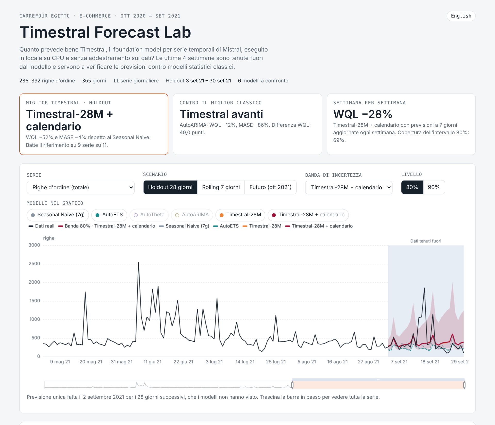

# Timestral Forecast Lab

[🇬🇧 English](README.md) · 🇮🇹 Italiano

Quanto prevede bene le vendite reali **Timestral**, il foundation model per serie temporali di Mistral AI, quando gira **in locale su CPU** e **senza essere addestrato sui dati** (zero-shot)?

Il progetto applica Timestral-28M a un anno di ordini online di Carrefour Egitto, tiene fuori le ultime 4 settimane e confronta le previsioni con quattro modelli statistici classici. I risultati si esplorano in una web app interattiva.

**▶ App online:** [Italiano](https://giancarlo-attianese.github.io/timestral-carrefour-forecast/it/) · [English](https://giancarlo-attianese.github.io/timestral-carrefour-forecast/en/)



## Risultati

11 serie giornaliere (righe d'ordine, fatturato netto, fatturato netto delle 8 categorie principali), 365 giorni da ottobre 2020 a settembre 2021. Gli errori sono relativi al **Seasonal Naive** (ripete la settimana precedente), con media geometrica sulle serie: **sotto 1 è meglio**.

**Holdout 28 giorni** (una sola previsione fatta il 2 settembre 2021 per il periodo 3–30 settembre)

| Modello | WQL relativo | MASE relativo | Copertura 80% | Serie vinte vs naive |
|---|---|---|---|---|
| **Timestral-28M + calendario** | **0,480** | **0,961** | 79% | 9/11 |
| **Timestral-28M** | 0,482 | 0,978 | 78% | 9/11 |
| AutoARIMA | 0,880 | 1,865 | 98% | 2/11 |
| AutoTheta | 0,904 | 1,063 | 98% | 2/11 |
| Seasonal Naive (7g) | 1,000 | 1,000 | 99% | – |
| AutoETS | 1,270 | 0,978 | 98% | 5/11 |

**Rolling 7 giorni** (quattro previsioni settimanali sulle stesse 4 settimane)

| Modello | WQL relativo | MASE relativo | Copertura 80% | Serie vinte vs naive |
|---|---|---|---|---|
| **Timestral-28M** | **0,702** | **0,839** | 70% | 9/11 |
| Timestral-28M + calendario | 0,723 | 0,862 | 69% | 9/11 |
| AutoARIMA | 0,944 | 1,194 | 95% | 2/11 |
| Seasonal Naive (7g) | 1,000 | 1,000 | 95% | – |
| AutoTheta | 1,023 | 1,202 | 94% | 2/11 |
| AutoETS | 1,029 | 1,166 | 93% | 3/11 |

**Cosa emerge**

- **Timestral vince sull'incertezza.** Il suo errore probabilistico (WQL) è circa la metà di quello del riferimento, e i suoi intervalli all'80% contengono il 78% dei giorni reali. I modelli classici assumono errori gaussiani: i picchi delle promozioni gonfiano la varianza, così i loro intervalli coprono il 93–99% dei giorni e sono troppo larghi per essere utili.
- **Sulla previsione puntuale il vantaggio è piccolo.** Timestral batte il riferimento su 9 serie su 11, ma in media è quasi alla pari sulle 4 settimane e migliore del 16% con aggiornamenti settimanali.
- **I picchi delle promozioni non li prevede nessun modello**, perché il dataset non contiene un calendario promozionale. Aggiungere il giorno della settimana come covariata non cambia quasi nulla.
- **Nelle previsioni settimanali gli intervalli sono un po' stretti** (copertura 70% invece di 80%).

## Metriche

| Metrica | Significato |
|---|---|
| MAE / RMSE | Errore medio assoluto / quadratico della mediana prevista, nell'unità della serie |
| sMAPE | Errore percentuale simmetrico (0–200%) |
| MASE | MAE diviso l'errore del naive stagionale settimanale sui dati di training |
| WQL | Perdita quantile pesata su 7 quantili (5–95%): valuta tutta la distribuzione prevista |
| Copertura 80% | Quota di giorni reali dentro l'intervallo 10–90% (ideale: 80%) |

## Modelli

- **Timestral-28M**: zero-shot, pesi ufficiali, solo CPU. La variante *+ calendario* riceve anche il giorno della settimana come covariata categorica nota in futuro.
- **Classici** ([statsforecast](https://github.com/Nixtla/statsforecast)): Seasonal Naive, AutoETS, AutoTheta, AutoARIMA, tutti con stagionalità settimanale e stimati su ogni serie.

Tutte le previsioni sono limitate a valori ≥ 0 e valutate sugli stessi quantili.

## Struttura del progetto

```
├── app/app_template.html   template della web app (testi in italiano, ECharts)
├── data/                   qui va Carrefour.csv (vedi data/README.md)
├── docs/                   web app compilata, pronta per GitHub Pages
│   ├── index.html          scelta della lingua
│   ├── it/index.html       versione italiana
│   └── en/index.html       versione inglese
├── results/                serie giornaliere, previsioni e metriche (JSON)
├── src/
│   ├── prep.py             aggrega le righe d'ordine in 11 serie giornaliere
│   ├── evalcore.py         split, quantili e metriche comuni a tutti i modelli
│   ├── baselines.py        modelli classici (statsforecast)
│   ├── run_timestral.py    Timestral su ogni taglia trovata in weights/
│   ├── bundle.py           raccoglie i risultati e calcola la classifica
│   └── build_app.py        genera la web app in italiano e in inglese
└── weights/                qui vanno i pesi di Timestral (vedi weights/README.md)
```

## Come eseguirlo

Serve Python 3.10 o successivo.

```bash
pip install -r requirements.txt

# 1. Dati e pesi (vedi data/README.md e weights/README.md)
# 2. Pipeline
python src/prep.py            # serie giornaliere
python src/baselines.py       # modelli classici (AutoARIMA richiede circa 3 minuti)
python src/run_timestral.py   # Timestral, pochi secondi su CPU
python src/bundle.py          # classifica
python src/build_app.py       # docs/it, docs/en
```

Per rigenerare solo la web app dai risultati già presenti nel repository bastano gli ultimi due comandi.

## Pubblicare l'app su GitHub Pages

Nelle impostazioni del repository vai su **Pages**, scegli **Deploy from a branch**, branch `main`, cartella `/docs`. L'app sarà online su `https://<username>.github.io/<nome-repository>/`.

## Crediti e licenze

- **Timestral**: [articolo](https://mistral.ai/news/timestral/), [codice](https://github.com/mistralai/timestral) (Apache 2.0), pesi su [Hugging Face](https://huggingface.co/collections/mistralai/timestral) (MIT modificata). I pesi non sono ridistribuiti qui.
- **Dataset**: [Carrefour Online Sales](https://www.kaggle.com/datasets/sherifhesham89/carrefour-online-sales) su Kaggle. Il file originale non è ridistribuito qui.
- Grafici: [Apache ECharts](https://echarts.apache.org/).

Autore: [Giancarlo Attianese](https://github.com/Giancarlo-Attianese)
