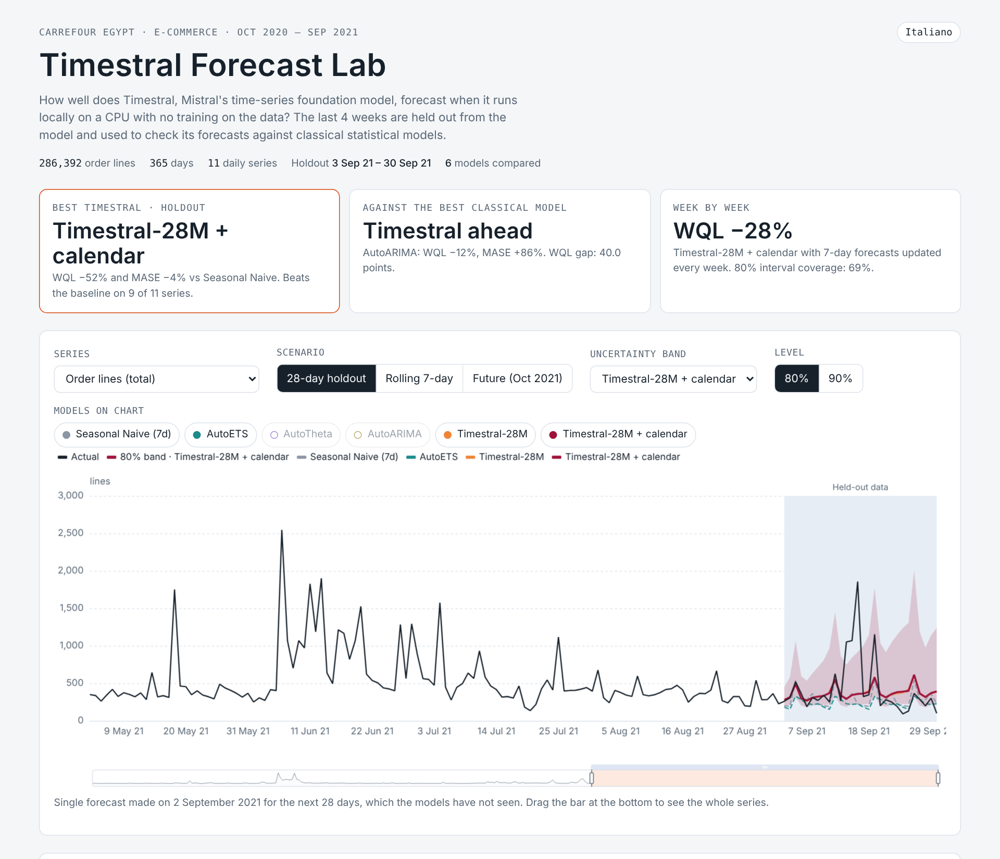

# Timestral Forecast Lab

🇬🇧 English · [🇮🇹 Italiano](README.it.md)

How well does **Timestral**, Mistral AI's time-series foundation model, forecast real retail sales when it runs **locally on a CPU** and is **never trained on the data** (zero-shot)?

This project runs Timestral-28M on one year of Carrefour Egypt online orders, holds out the last 4 weeks, and compares its forecasts with four classical statistical models. The results are shown in an interactive web app.

**▶ Live app:** [Italiano](https://giancarlo-attianese.github.io/timestral-carrefour-forecast/it/) · [English](https://giancarlo-attianese.github.io/timestral-carrefour-forecast/en/)



## Results

11 daily series (order lines, net revenue, net revenue for the top 8 categories), 365 days from October 2020 to September 2021. Errors are relative to **Seasonal Naive** (repeat last week), geometric mean across series: **below 1 is better**.

**28-day holdout** (single forecast made on 2 Sep 2021 for 3–30 Sep 2021)

| Model | Relative WQL | Relative MASE | 80% coverage | Series won vs naive |
|---|---|---|---|---|
| **Timestral-28M + calendar** | **0.480** | **0.961** | 79% | 9/11 |
| **Timestral-28M** | 0.482 | 0.978 | 78% | 9/11 |
| AutoARIMA | 0.880 | 1.865 | 98% | 2/11 |
| AutoTheta | 0.904 | 1.063 | 98% | 2/11 |
| Seasonal Naive (7d) | 1.000 | 1.000 | 99% | – |
| AutoETS | 1.270 | 0.978 | 98% | 5/11 |

**Rolling 7-day** (four weekly forecasts over the same 4 weeks)

| Model | Relative WQL | Relative MASE | 80% coverage | Series won vs naive |
|---|---|---|---|---|
| **Timestral-28M** | **0.702** | **0.839** | 70% | 9/11 |
| Timestral-28M + calendar | 0.723 | 0.862 | 69% | 9/11 |
| AutoARIMA | 0.944 | 1.194 | 95% | 2/11 |
| Seasonal Naive (7d) | 1.000 | 1.000 | 95% | – |
| AutoTheta | 1.023 | 1.202 | 94% | 2/11 |
| AutoETS | 1.029 | 1.166 | 93% | 3/11 |

**What this shows**

- **Uncertainty is where Timestral wins.** Its probabilistic error (WQL) is about half that of the baseline, and its 80% intervals contain 78% of the actual days. The classical models assume Gaussian errors: promotion spikes inflate their variance, so their intervals cover 93–99% of the days and are too wide to be useful.
- **On the point forecast the gain is small.** Timestral beats the baseline on 9 of 11 series, but on average it is roughly level over 4 weeks and 16% better with weekly updates.
- **Promotion spikes are not predictable** by any model here, because the dataset has no promotion calendar. Adding the day of the week as a covariate changes almost nothing.
- **Weekly forecasts have intervals that are slightly too narrow** (70% coverage instead of 80%).

## Metrics

| Metric | Meaning |
|---|---|
| MAE / RMSE | Mean absolute / root mean squared error of the median forecast, in the series' unit |
| sMAPE | Symmetric percentage error (0–200%) |
| MASE | MAE divided by the in-sample error of the weekly seasonal naive |
| WQL | Weighted quantile loss over 7 quantiles (5–95%): scores the whole forecast distribution |
| 80% coverage | Share of actual days inside the 10–90% interval (ideal: 80%) |

## Models

- **Timestral-28M**: zero-shot, official weights, CPU only. The *+ calendar* variant also receives the day of the week as a known-future categorical covariate.
- **Classical** ([statsforecast](https://github.com/Nixtla/statsforecast)): Seasonal Naive, AutoETS, AutoTheta, AutoARIMA, all with weekly seasonality and fitted on each series.

All forecasts are clipped at ≥ 0 and scored on the same quantiles.

## Project structure

```
├── app/app_template.html   web app template (Italian source text, ECharts)
├── data/                   put Carrefour.csv here (see data/README.md)
├── docs/                   built web app, ready for GitHub Pages
│   ├── index.html          language picker
│   ├── it/index.html       Italian version
│   └── en/index.html       English version
├── results/                daily series, forecasts and metrics (JSON)
├── src/
│   ├── prep.py             aggregate order lines into 11 daily series
│   ├── evalcore.py         splits, quantiles and metrics shared by all models
│   ├── baselines.py        classical models (statsforecast)
│   ├── run_timestral.py    Timestral on every size found in weights/
│   ├── bundle.py           collect results and compute the leaderboard
│   └── build_app.py        build the Italian and English web apps
└── weights/                put the Timestral weights here (see weights/README.md)
```

## Run it

Requires Python 3.10 or later.

```bash
pip install -r requirements.txt

# 1. Data and weights (see data/README.md and weights/README.md)
# 2. Pipeline
python src/prep.py            # daily series
python src/baselines.py       # classical models (AutoARIMA takes about 3 minutes)
python src/run_timestral.py   # Timestral, a few seconds on CPU
python src/bundle.py          # leaderboard
python src/build_app.py       # docs/it, docs/en
```

To rebuild only the web app from the results already in the repository, run the last two commands.

## Publishing the app on GitHub Pages

In the repository settings go to **Pages**, choose **Deploy from a branch**, branch `main`, folder `/docs`. The app is then served at `https://<username>.github.io/<repository-name>/`.

## Credits and licenses

- **Timestral**: [blog post](https://mistral.ai/news/timestral/), [code](https://github.com/mistralai/timestral) (Apache 2.0), weights on [Hugging Face](https://huggingface.co/collections/mistralai/timestral) (Modified MIT). Weights are not redistributed here.
- **Dataset**: [Carrefour Online Sales](https://www.kaggle.com/datasets/sherifhesham89/carrefour-online-sales) on Kaggle. The raw file is not redistributed here.
- Charts: [Apache ECharts](https://echarts.apache.org/).

Author: [Giancarlo Attianese](https://github.com/Giancarlo-Attianese)
